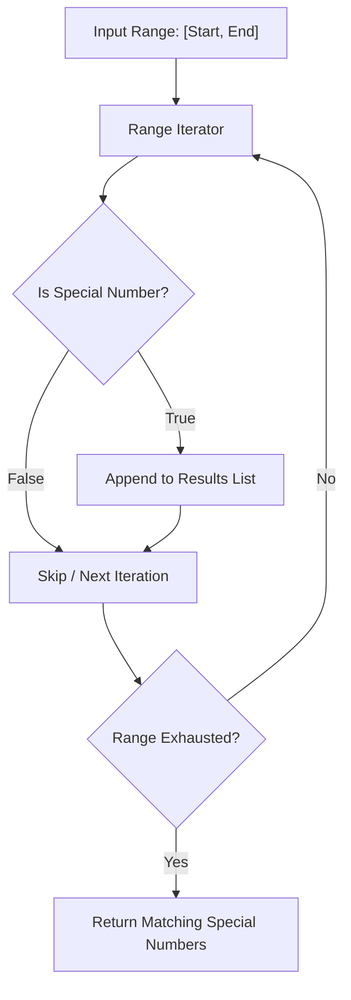

<p align="center">
  
</p>

<p align="center">
  
  
  
  
</p>

---

## Executive Summary / Overview
### Problem Statement & Context
While verifying a single special number is straightforward, scanning an expansive numerical interval [A, B] requires minimizing redundant calculations and applying early-exit pruning to avoid unneeded factorial evaluations.

### Solution Overview
This repository implements a **Range-Based Special Number Filter** in Python. The implementation sweeps across arbitrary intervals, filtering and aggregating numbers whose digit-factorial sum strictly matches their identity.

---

## Interactive Table of Contents
- [Executive Summary / Overview](#executive-summary--overview)
- [Key Features & Capabilities](#key-features--capabilities)
- [System Architecture / Pipeline](#system-architecture--pipeline)
- [Tech Stack Breakdown](#tech-stack-breakdown)
- [Reproducible Quickstart & Setup](#reproducible-quickstart--setup)
- [Project Directory Layout](#project-directory-layout)
- [Author & Contributions](#author--contributions)

---

## Key Features & Capabilities
- **Bounded Interval Search:** Iterates through user-defined lower and upper bounds [A, B].
- **Modular Function Isolation:** Decouples the single-number verification predicate from the interval scanning engine.
- **Result Aggregation:** Accumulates discovered special numbers into clean Python lists for further analysis.

---

## System Architecture / Pipeline


---

## Tech Stack Breakdown
| Layer | Technology | Role |
| :--- | :--- | :--- |
| **Languages** | Python 3.10+ | Standard mathematical expressions and loops |
| **Libraries** | Python Standard Library | Integer range generators and list collections |
| **Tools** | Jupyter Notebook | Stepwise evaluation and demonstration |
| **Architecture** | Interval Filter Pipeline | Bounded range iteration with predicate validation |

---

## Reproducible Quickstart & Setup
```bash
# 1. Clone repository
git clone https://github.com/suryateja-155/spl-numbers.git
cd spl-numbers

# 2. Run notebook
jupyter notebook "speacial numbers between the range.ipynb"
```

---

## Project Directory Layout
```text
spl-numbers/
├── speacial numbers between the range.ipynb # Range filtering and search logic
└── README.md                                # Algorithmic optimization guide
```

---

## Author & Contributions

**Gettupalli Surya Teja**  
- GitHub Profile: [@suryateja-155](https://github.com/suryateja-155)  
- Portfolio Index: [Gettupalli-Surya-Teja](https://github.com/suryateja-155/Gettupalli-Surya-Teja)

Contributions, issue reports, and feedback are always welcome! Feel free to open an issue or pull request.

<p align="center">
  
</p>
